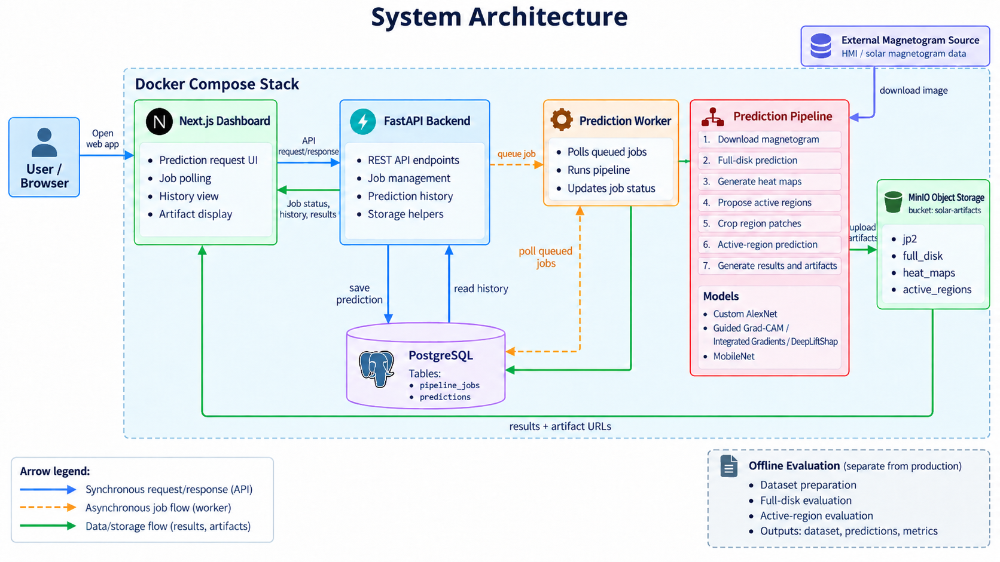
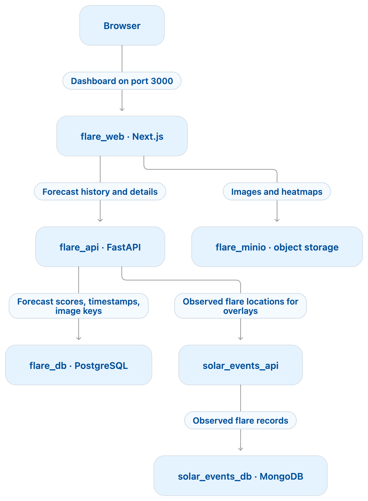

# Solar Flare Forecasting
This repo presents the web application and deep learning pipeline that integrates full-disk solar flare prediction model and active region prediction models. Using three explainability methods (i) Guided Gradient=weighted Class Activation Mapping, (ii) Deep Shapley Additive Exaplantions, and (iii) Integrated Gradients.

## Architecture



### Docker containers



`make up` starts the six dashboard, API, and storage services and runs
`createbuckets`. The setup container exits after preparing the MinIO bucket.
The `predictor` starts on demand for an hourly forecast or a backfill. It fetches
a magnetogram from Helioviewer, uploads forecast images to MinIO, saves the
forecast in PostgreSQL, and exits. The [host timer](#hourly-deployment) is
enabled separately.

## Demo

[Watch the demo video on YouTube](https://youtu.be/VvdGnm-D_tU)

## Structure

- `app/`: backend server
- `web/`: dashboard for live forecasts and prediction history.
- `solar-events-service/`: observed flare catalog and API for overlays.
- `deploy/systemd/`: optional hourly forecast timer and service for Linux hosts.
- `prediction/pipeline/`: inference stages used by the application.
- `prediction/run_forecast.py`: publish one forecast or replay a UTC date range.
- `prediction/modeling/`: model architectures and trained weights.
- `prediction/evaluation/`: Offline dataset preparation, model evaluation, and
  localization analysis. These utilities reuse selected production pipeline
  stages but are not imported by the production forecast runner.

## Source Code Documentation

1. download_2025_magnetograms.py: This function downloads HMI Magnetograms at every mid night (if present) in 2025. These HMI magnetograms will then be used for evaluation.
2. labels.py: The function `create_24h_labels()` creates dataset.csv with lables for existing 2025 HMI JPGs. `true_label` is 1 when an M- or X-class flare peaks in the interval [magnetogram timestamp, timestamp + 24 hours), otherwise 0. 
3. `dataset.py`: This class loads the labled full-disk magnetograms listed in a dataset CSV.
4. `localization.py`: Parses flare-event positions, projects their heliographic coordinates into image pixels, matches them to proposed active-region hulls, and creates diagnostic overlays.

  ### Full-disk evaluation — `evaluate_full_disk.py`

  The full-disk evaluation entry point evaluates the fold-1 full-disk
  classifier over the 2025 magnetogram archive. It first creates 24-hour
  M/X-flare labels, loads the labeled magnetograms in batches, runs softmax
  inference with the trained fold-1 `Custom_AlexNet` checkpoint (on CPU or
  CUDA), applies a `0.5` flare-probability threshold, and writes both per-image
  predictions and summary metrics.

  Run it with:

  ```sh
  python -m prediction.evaluation.evaluate_full_disk
  ```

  Its outputs are written to `data/evaluation_2025/`:

  - `dataset.csv`: one 2025 magnetogram per row, with timestamp, image path,
    and the next-24-hour M/X flare label.
  - `full_disk_predictions.csv`: true labels, class probabilities, and binary
    predictions for every evaluated image.
  - `metrics.csv`: TN, FP, FN, TP, accuracy, precision, recall, F1, TSS, and
    HSS for the full-disk model.

  ### Active-region evaluation — `evaluate_ar.py`

  The active-region evaluation entry point evaluates the MobileNet
  active-region classifier on regions proposed from each 2025 full-disk
  magnetogram. For every image, it generates attribution-based region hulls,
  projects catalogued M/X-flare active-region locations from `data/events.csv`
  into the 512px image coordinate system, labels proposals by whether they
  contain a catalogued active region, crops each proposal from the matching
  JP2 magnetogram, and classifies the crop at a `0.5` threshold. It also saves
  an overlay whenever a magnetogram has catalogued active regions.

  Run it with:

  ```sh
  python -m prediction.evaluation.evaluate_ar
  ```

  Its outputs are written to `data/active_region_evaluation_2025/`:

  - `active_region_predictions.csv`: one row per proposed region, including
    its rank, true label, flare probability, and predicted label.
  - `metrics.csv`: TN, FP, FN, TP, accuracy, precision, recall, F1, TSS, and
    HSS for active-region proposals.
  - `final_hulls_with_actual_ars/`: diagnostic overlays of proposal hulls and
    projected catalogue active-region locations.

## Quick Start

### Docker Compose

Start Docker and run these commands from the repository root. Keep your
existing `.env` if you've already configured one.

```sh
test -f .env || cp .env.example .env
make up
make ps
```

Open the [dashboard](http://localhost:3000). It can display existing forecasts
as soon as the API is ready. A fresh database starts with an empty history.

To generate your first forecast, fetch the checkpoints with Git LFS and run
the predictor:

```sh
git lfs pull
make predict-hour
```

If the current magnetogram hasn't arrived yet, try a historical hour with
`make predict-hour HOUR=2026-09-07T15:00:00Z`. See [Backfill](#backfill) to
populate a range of forecast history.

On first startup, the solar-events API imports the bundled observed-flare
catalog into MongoDB, including NOAA region IDs and available quality flags.
The snapshot ends on April 3, 2026. Run `make scrape-events` to fetch additional
LMSAL records for overlays.

### Hourly deployment

The `predictor` Compose service is a one-shot container. The dashboard and API
start with the normal stack. On a Linux Compose host, use the checked-in
[systemd service](deploy/systemd/flare-forecast.service) and
[timer](deploy/systemd/flare-forecast.timer). They assume the deployment lives
at `/opt/flare-dashboard` and Docker is at `/usr/bin/docker`. Adjust the service
if your directory, Docker executable, or Compose files differ.

Stop any legacy prediction worker before the cutover. From the deployment
directory, build the predictor and verify it can publish a forecast:

```sh
docker compose build predictor
docker compose run --rm -T predictor --current-hour --attempts 3
```

Once the one-shot run succeeds and its images load in the dashboard, install
the timer:

```sh
sudo install -m 0644 deploy/systemd/flare-forecast.{service,timer} /etc/systemd/system/
sudo systemctl daemon-reload
sudo systemctl enable --now flare-forecast.timer
systemctl list-timers flare-forecast.timer
journalctl -u flare-forecast.service
```

The timer starts at five minutes past each UTC hour. The runner fixes the
forecast slot at startup and makes up to three attempts, one minute apart.
Adjust the five-minute starting offset once you have measured HMI availability
and runtime on the deployment host. Helioviewer can lag even after those retries.
If no observation qualifies, the run exits nonzero and the dashboard continues
to show its last successful forecasts. To recover a missed hour after the image
arrives, run the same command with `--hour 2026-11-17T15:00:00Z` in place of
`--current-hour`. A hosting platform with scheduled jobs can invoke the same
predictor container.

### Local development

Create `.env` from `.env.example` in the repository root and create
`web/.env.local` from `web/.env.local.example`. Install dependencies, then run
the API and frontend in separate terminals:

```sh
# Install Python dependencies
python -m pip install -r requirements.txt

# Terminal 1: API
uvicorn app.main:app --reload

# Terminal 2: frontend
cd web
npm install
npm run dev
```

Services:

- Dashboard: `http://localhost:3000`
- API: `http://localhost:8000`
- API health: `http://localhost:8000/health`
- Solar events API: `http://localhost:8001` (MongoDB-backed)
- Solar events MongoDB: `mongodb://localhost:27017`
- MinIO API: `http://localhost:9000`
- MinIO console: `http://localhost:9001`

The model weights are mounted read-only into predictor containers. The Docker build includes only the two checkpoints used for inference.

When the dashboard opens an individual prediction, it requests `GET /history/{prediction_id}`. The API queries the solar-events service for actual M/X flare regions from one hour before through one hour after the prediction timestamp and, when locations are available, returns an `actual_flare_overlay_url` with those locations marked on the candidate-region image. Set `SOLAR_EVENTS_SERVICE_URL` to override the default internal Compose URL.

## Common Commands

```sh
make help                 # List available commands
make up                   # Create and start the stack
make ps                   # Check which services are running
make logs SERVICE=api     # Follow logs for one service
make predict-hour         # Generate the current UTC hour's forecast
make stop                 # Stop the stack
make start                # Start existing containers again
make down                 # Remove containers and keep stored data
```

Use `make build SERVICE=predictor` to build the prediction image ahead of time.
`make shutdown` also deletes the volumes that hold forecasts, images, and
observed flare records.

## Backfill

Run a small batch against local PostgreSQL and MinIO first. Dates are UTC
and the end date is inclusive through 23:00:

```sh
make backfill START_TIME=2026-01-01 END_TIME=2026-01-01
```

Then run longer batches up to the hour before the production cutover. Existing
forecasts are skipped. The command continues through failures, logs their
hours, and exits nonzero if any hour failed. Rerun the same range or retry a
single failed hour with `make predict-hour HOUR=2026-01-01T15:00:00Z`.

The backfill creates the same full-disk images, heatmaps, and active-region
crops as a scheduled run. To migrate a locally populated archive, copy the
MinIO objects with their original keys first. Then import the corresponding
`predictions` rows, preserving existing production forecasts on any matching
UTC slot. Verify a sample of archive predictions and image links before
expanding the range.

## Offline Evaluation

Download one full-resolution HMI magnetogram per day for 365 days in 2025,
starting at midnight, and convert each JP2 to JPG:

```sh
python -m prediction.evaluation.download_2025_magnetograms
```

To invoke it from Python instead:

```python
from prediction.evaluation.download_2025_magnetograms import download_2025_magnetograms

download_2025_magnetograms()
```

Files are written under:

```text
data/YYYY/MM/DD/HH/mm/ss/jp2/
data/YYYY/MM/DD/HH/mm/ss/jpg/
```

The downloader reuses existing JP2 files and skips existing JPG conversions.
Run the complete 2025 evaluation after the archive is available:

```sh
python -m prediction.evaluation.evaluate_full_disk
```

This creates `data/evaluation_2025/dataset.csv`, runs batched inference, and
writes `full_disk_predictions.csv` and `metrics.csv`. See
`prediction/evaluation/README.md` for the offline package structure.

## Forecast Flow

1. The scheduled run or backfill selects an explicit hourly UTC slot.
2. The runner skips published forecasts and uses the same PostgreSQL lock for
   concurrent attempts at the same hour.
3. The pipeline uses an HMI image observed at or within 12 minutes before the
   slot. The forecast is for the next 24 hours from the slot. The magnetogram
   timestamp is saved separately from the slot and the publication time.
4. The runner uploads artifacts before committing the prediction row. An
   interrupted run can be retried using the same hour.
5. The live dashboard refreshes every minute and shows the latest 24 successful
   forecasts in descending slot order. History supports date and class filters.

## API

- `GET /health`
- `GET /history/`
- `GET /history/{prediction_id}`
- `GET /predictions/jobs/summary` and `GET /predictions/jobs/{job_id}` read legacy job records.

## Pipeline

The pipeline in `prediction/pipeline/run_pipeline.py`:

1. Downloads an HMI JP2 and converts it to a full-disk JPG.
2. Runs the fold-1 full-disk classifier.
3. Generates Guided Grad-CAM, Integrated Gradients, and DeepLiftShap maps in memory.
4. Extracts buffered bounding regions from each attribution map and intersects
   their masks, retaining only pixels covered by all three attribution methods.
5. Discards every non-shared portion and applies the solar-disk mask to the
   retained intersection regions.
6. Saves the buffered solar mask.
7. Produces padded fixed-size `512x512` active-region crops.
8. Runs active-region model inference.

Every retained merged region is an active-region proposal. Proposals are ranked by a normalized area-weighted consensus score: mean fused heatmap intensity inside the polygon multiplied by `log1p(region_area) / log1p(max_region_area)`.

The predictor passes the requested slot to the pipeline. Model selections,
thresholds, crop size,
clustering settings, and proposal buffers are named constants in
`run_pipeline.py` and `region_proposal.py`.

## Artifact Storage

The runner uses an isolated temporary directory for each attempt and removes it
after publishing the forecast or reporting a failure.

MinIO object keys:

```text
predictions/YYYY/MM/DD/HH/full_disk/{filename}
predictions/YYYY/MM/DD/HH/heat_maps/{buffered-mask-filename}
predictions/YYYY/MM/DD/HH/active_regions/{filename}
```

The runner keeps the JP2 as an intermediate input. PostgreSQL stores the keys
for the uploaded images. The browser requests them through the Next.js
`/api/artifacts` route, which reads from `MINIO_ARTIFACT_BASE_URL`. Compose
defaults to `http://minio:9000/solar-artifacts` on the internal network.

## Environment

The main settings are defined in `.env.example`:

- `DATABASE_URL`: Postgres connection used by the API and predictor.
- `MINIO_ENDPOINT`, `MINIO_ACCESS_KEY`, `MINIO_SECRET_KEY`, `MINIO_BUCKET`.

Compose uses service hostnames such as `db` and `minio`. Local processes outside Docker should use reachable hostnames such as `localhost`.

## Troubleshooting

- Scheduled forecast failures: `journalctl -u flare-forecast.service`
- Missing images: check `make ps` and verify that the web container's
  `MINIO_ARTIFACT_BASE_URL` points to the bucket that contains the artifacts.
- Stale service image: rebuild only that service with `make rebuild SERVICE=<service>`.
- Clean reset: run `make shutdown`, then `make build` and `make up`.

## Tests

Build the isolated test images and run all three suites:

```bash
make test
```

To run an individual suite:

```bash
make test-api
make test-solar-events
make test-web
```

## Continuous Integration

GitHub Actions runs the three Dockerized test suites in parallel for every
commit pushed to any branch and for every pull request. The workflow can also
be started manually from the Actions tab. It uses the same `make test-api`,
`make test-solar-events`, and `make test-web` commands used during development,
so local and CI behavior stay aligned.

The workflow is defined in `.github/workflows/ci.yml`. It grants read-only
repository permissions, cancels superseded runs on the same branch or pull
request, and reports each service suite as a separate required-check candidate.
